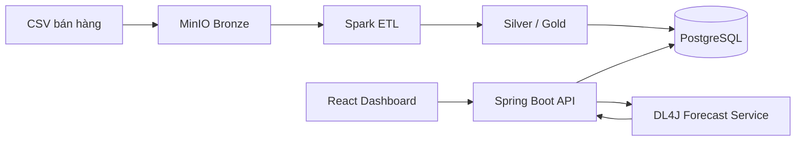

# Sales Demand Forecasting DL4J

Hệ thống dự báo nhu cầu bán hàng 7 ngày cho Store 1 và 50 sản phẩm. Dự án kết hợp DL4J,
Spark Standalone, MinIO, PostgreSQL, Spring Boot, React/TypeScript và Docker Compose.



## Yêu cầu

- Windows 11, PowerShell và Docker Desktop chạy Linux containers qua WSL2;
- JDK 11 và Maven 3.6.3 trở lên;
- `data/train.csv` theo schema `date,store,item,sales`;
- deployment package được chỉ định bởi `MODEL_ARTIFACT_DIR`.

GPU/CUDA chỉ cần cho huấn luyện. Docker Forecast Service phục vụ inference bằng CPU.

## Bắt đầu nhanh

```powershell
.\project.ps1 setup
.\project.ps1 up
.\project.ps1 status
```

Các URL mặc định:

| Thành phần | URL |
| --- | --- |
| Dashboard | <http://localhost:3000> |
| Backend API | <http://localhost:8084/api> |
| Forecast Service | <http://localhost:8083> |
| Spark Master | <http://localhost:8080> |
| MinIO Console | <http://localhost:9001> |

Các lệnh thường dùng:

```powershell
.\project.ps1 help
.\project.ps1 smoke
.\project.ps1 test
.\project.ps1 results
.\project.ps1 down
```

Full training không chạy mặc định và bắt buộc xác nhận rõ:

```powershell
.\project.ps1 train -ConfirmFullRun
```

## Cấu trúc cấp cao

```text
data/          dữ liệu local và sample
output/        training, evaluation, smoke, benchmark và log sinh khi chạy
artifacts/     manifest và model/scaler đã được quản lý để triển khai
docs/          tài liệu Markdown, sơ đồ và chỉ mục kết quả
scripts/       implementation scripts được project.ps1 điều phối
src/           Java/DL4J core và Forecast Service
spark-etl/     Spark jobs
backend-api/   Spring Boot API
frontend/      React/TypeScript Dashboard
```

`output/runs/` là vùng lịch sử bất biến. Run mới được ghi theo loại vào `output/training/`,
`output/evaluation/`, `output/smoke-tests/` hoặc `output/benchmarks/`.

## Tài liệu

- [Bắt đầu và cấu hình](docs/01-getting-started/quick-start.md)
- [Kiến trúc và sơ đồ](docs/02-architecture/system-overview.md)
- [Dữ liệu và Data Lake](docs/03-data/bronze-silver-gold.md)
- [Huấn luyện](docs/04-training/training-guide.md)
- [Đánh giá và kết quả mô hình](docs/05-evaluation/global-model-results.md)
- [Triển khai Docker](docs/06-deployment/docker-deployment.md)
- [Phân loại kiểm thử](docs/07-testing/testing-overview.md)
- [Benchmark](docs/08-benchmarks/benchmark-methodology.md)
- [Tham chiếu lệnh](docs/09-operations/command-reference.md)
- [Chỉ mục kết quả](docs/10-results/results-index.md)
- [Audit và trạng thái dự án](docs/project-management/current-state.md)

## Dữ liệu và giấy phép

Repository không phân phối dataset, checkpoint hoặc output runtime. Người dùng tự cung cấp dữ liệu
và chịu trách nhiệm về quyền sử dụng. Mã nguồn dùng giấy phép trong [LICENSE](LICENSE).
