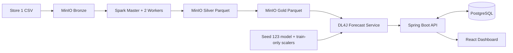

# 01. Kiến trúc Big Data

Giai đoạn 1 tạo network, volume và service topology. `forecast-service`, `backend-api` và `frontend` hiện là bootstrap có healthcheck để kiểm tra orchestration; chưa phải implementation nghiệp vụ. Spark ETL, DL4J serving, Spring Boot và React lần lượt được thay thế ở các giai đoạn sau.

Ngân sách mặc định cho máy phát triển: mỗi Spark worker 1 core/1 GiB, tổng limit container xấp xỉ 6 GiB. Các credential ví dụ chỉ dùng local và phải đổi trong `.env`.

