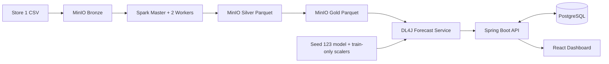

# 01. Kiến trúc Big Data

Forecast Service, Spring Boot Backend và React Dashboard hiện đã thay bootstrap. Backend chạy Flyway,
nhập Store 1 vào PostgreSQL, gọi Forecast Service qua mạng nội bộ và lưu lịch sử dự báo. Frontend chỉ
gọi Backend qua reverse proxy `/api`, không truy cập MinIO trực tiếp.

Ngân sách mặc định cho máy phát triển: mỗi Spark worker 1 core/1 GiB, tổng limit container xấp xỉ 6 GiB. Các credential ví dụ chỉ dùng local và phải đổi trong `.env`.

