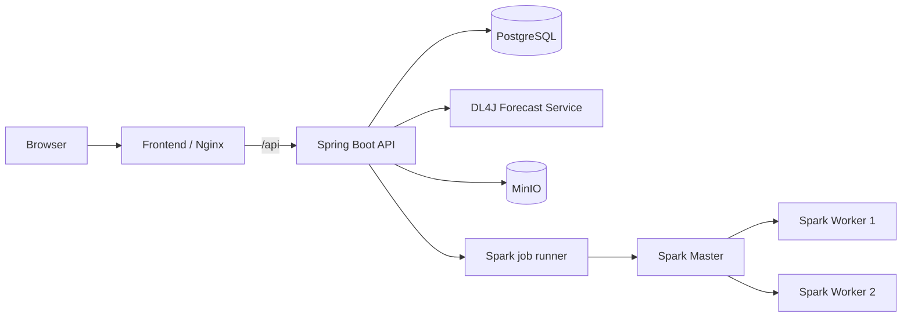
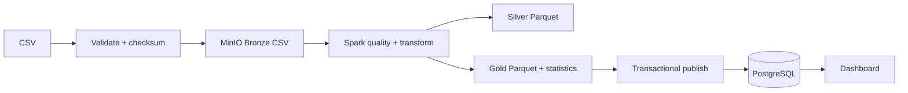
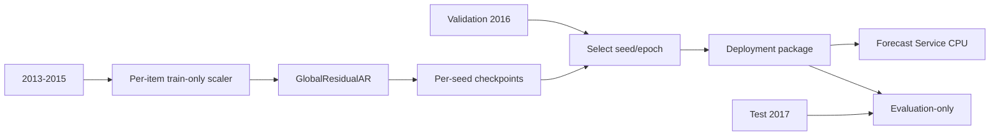
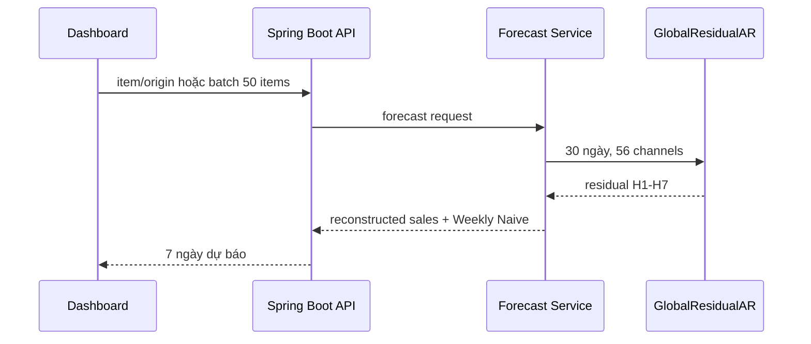

# Sơ đồ kiến trúc

Các sơ đồ phản ánh thành phần hiện có trong source và Compose.

## Docker và request flow

## Ingestion và Data Lake

## Training, checkpoint và deployment

## Inference H1-H7

Artifact active vẫn được mount từ đường dẫn lịch sử. Manifest compatibility nằm tại
`artifacts/manifests/current-model.json`.
