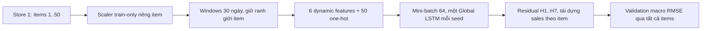

# Một cửa hàng, nhiều sản phẩm: Global ResidualAR

**IMPLEMENTED: YES / TESTED: YES / SMOKE TESTED: YES / FULL GLOBAL EXPERIMENT: NOT RUN.**
Đã train một model chung nhiều item ở synthetic và smoke; chưa train full 50 items × 5 seed.

## Phạm vi ứng dụng

Pipeline nghiên cứu 12 independent representative series được giữ nguyên với toàn bộ artifact.
Pipeline ứng dụng mới: **Store 1, tất cả 50 items, một Global ResidualAR-MSE mỗi seed**.
50 items là dữ liệu của model chung, không phải 50 models hoặc 50 output neurons.
Full có 5 global fits cho seeds 42, 123, 2026, 7, 99. Không dùng Weekly macro 11,1435 của
12 chuỗi làm đối chứng; Weekly được tính lại trên đúng Store/items/windows của run mới.



## Dữ liệu, identity và scaler

`TimeSeriesAnalyzer.analyzeStoreQuietly` đọc CSV một lần, lọc store rồi sắp xếp từng item.
Global loader yêu cầu đủ IDs 1–50, lịch 2013-01-01..2017-12-31; missing/duplicate dates
bị SalesPreprocessor từ chối. Full không chọn đại diện hoặc bỏ item khó. Smoke chọn cố định
IDs 1,25,50 (không dựa metric); đây chỉ là tập nhỏ kiểm tra pipeline, không là đại diện thống kê.

Tái sử dụng SalesPreprocessor: train 2013–2015, validation 2016, test 2017; window 30→7,
feature warm-up 14 ngày, toàn bộ target trong một split. Global dataset giữ item/scaler cùng
window và không nối raw series. Test split được dựng như pipeline cũ nhưng không đưa vào
global training/evaluation. Test 2017 từng được quan sát lịch sử, không là pristine holdout.

Min–Max riêng item chỉ fit sales train; constant scale=1. Sáu features gồm sales, lag7,
rolling7/14, weekday sin/cos. Rolling dùng current/past theo policy cũ. One-hot 50 chiều
repeat mỗi timestep, channel = dynamicFeatureCount + itemId − 1; không có store embedding.
FeatureCount derive từ danh sách dynamic features và identity count: **56** cả full lẫn smoke.

```text
features: [batch,56,30]
labels: [batch,1,30]; label mask [batch,30], chỉ bước cuối = 1
label_i = (actual_i(t) - observed_i(t-7)) / trainSalesScale_i
salesPrediction_i = observed_i(t-7) + networkOutput_i * trainSalesScale_i
```

Không fit residual scaler, cộng trainMin, clip, Huber, log1p hoặc biến ngoài.
H1–H7 giữ cùng identity/scaler của item. Anchor kiểm tra targetDate−7; rollout feed sales đã
tái dựng và rebuild causal features từ history, actual tương lai chỉ tính metric.

## Model và batching

LSTM 32 units/TANH → output 1/IDENTITY, MSE, Adam 0,001. Tối đa 30 epoch, patience 5.
Chỉ có một network được tạo trong mỗi fit, nhận windows của toàn bộ items. Mỗi epoch shuffle
train windows bằng Java Random(seed + 1000003 × epoch), không đổi chronology trong sample.
Validation giữ thứ tự item/ngày, không shuffle, chia batch để giới hạn tensor memory.
Không weighting, oversampling hoặc undersampling; report window count từng item.

Batch mặc định 64 nằm trong ExperimentConfiguration; optional `--batch-size=32` hoặc 16 để
xử lý OOM có ghi nhận, không giảm items/history/horizon. Không tự đổi batch hoặc dữ liệu khi lỗi.
Tensor tạo từ float buffer trên CPU rồi copy theo batch; giải phóng tensor sau dùng. Best params
copy/restore theo **macro RMSE validation H1–H7 sales**; không theo pooled RMSE/scaled loss.
History chỉ giữ metric, không giữ predictions mọi epoch. Network giải phóng sau mỗi fit.
Chưa lưu network/checkpoint ra đĩa để deploy/resume; artifact hiện phục vụ validation experiment.

Train loss báo sample-weighted mean của score mini-batch sau update: weights thay đổi trong epoch,
không phải một lần score toàn bộ train tại weights cuối epoch. Đây không phải checkpoint criterion.
Lưu train_seconds và validation_seconds từng epoch để đo thời gian thay vì suy ra từ số fits cũ.

## Quy mô và bộ nhớ

Đã kiểm tra CSV thật: Store 1 đủ IDs 1–50, mỗi item 1.826 ngày, không trùng ngày.
Full theo protocol có 1.046 train windows/item và 360 validation origins/item:

| Quy mô | Full | Smoke |
| --- | ---: | ---: |
| Items | 50 | 3 (1,25,50) |
| Train windows | 52.300 | 3.138 |
| Validation origins | 18.000 | 1.080 |
| Forecasts/seed | 126.000 | 7.560 |
| Seeds/global fits | 5 | 1 |
| Epoch tối đa/fit | 30 | 2 |
| Training batches/epoch (64) | 818 | 50 |

Input batch64 float32 = 430.080 bytes ≈0,4102 MiB; labels + mask ≈0,01465 MiB.
Full input tensor nếu materialize là ≈335,17 MiB; implementation không tạo tensor đó.
Ước lượng này không gồm activations, gradients, CUDA workspace và Java objects/windows trên CPU;
không đồng nghĩa tổng VRAM/heap chỉ 0,41 MiB. Full runtime chưa đo, không ngoại suy từ 5 fits
của pipeline khác như thể mỗi fit có cùng chi phí.

## Lệnh chạy

```powershell
Set-Location 'C:\Users\quangTam\Documents\DL4j\sales-demand-forecasting-dl4j'
New-Item -ItemType Directory -Force output | Out-Null
mvn -B compile exec:java '-Dexec.args=--global-store-smoke'
```

Full (chủ động chạy riêng sau khi implementation/test/smoke đã kiểm chứng):

```powershell
Set-Location 'C:\Users\quangTam\Documents\DL4j\sales-demand-forecasting-dl4j'
$globalRunLog = 'output/global-full-' + (Get-Date -Format 'yyyy-MM-dd_HHmmss') + '.log'
mvn -B clean compile exec:java '-Dexec.args=--global-store=1' 2>&1 | Tee-Object -FilePath $globalRunLog
$globalExitCode = $LASTEXITCODE
```

Đổi store qua `--global-store=2` hoặc `--global-store-smoke=2`, không sửa source.
Ví dụ xử lý OOM: `'-Dexec.args=--global-store=1 --batch-size=32'`; đây phải là run mới có
manifest batch mới. Không compile/test/IDE auto-build khi train; lưu đủ log, không tail liên tục.

## Artifact schema 4

Reuse RunArtifactSession: directory độc quyền `output/runs/<run-id>/`, dataset SHA-256,
Java/backend, console.log, latest.txt, trạng thái RUNNING/SUCCESS/FAILED và ghi manifest nguyên tử.
Không sửa run cũ. Schema 1–3/legacy CLI vẫn giữ nguyên; global có tên CSV riêng:

- `global-series-scaling.csv`: store/item, train min/max/scale/mean, train/validation window count.
- `global-validation-predictions.csv`: store/item/seed/model, origin/target/horizon, actual_sales,
  weekly_baseline, predicted_residual và predicted_sales ở sales gốc.
- `global-item-seed-metrics.csv`: mỗi item/seed một dòng, MAE/RMSE, best epoch/epochs run/count.
- `global-epoch-history.csv`: mỗi seed/epoch một dòng, scaled train loss, macro/pooled MAE/RMSE,
  best flag và train/validation seconds. Một best flag mỗi global fit, không phải mỗi item.
- `summary.txt`, `error-analysis.txt`, `report.html`: dataset, overall, per-item, win rate,
  H1–H7, demand tiers theo train mean (chỉ report), seed stability.

Manifest ghi store/itemIds, identity mapping, dynamic/identity/total channels, batch, target/loss,
scaling policy, periods, checkpoint criterion, fits/seeds, tensor estimate và testUsedForSelection=false.
Full expected: 50 scaler rows, 250 item-seed rows, 630.000 prediction rows, 5 best flags.
SUCCESS chỉ sau export đủ và coverage đúng; Java failure/đóng session chưa complete ghi FAILED.
Kill JVM cưỡng bức/mất điện có thể để RUNNING; không coi partial là completed. Không resume.

## Aggregation và diễn giải

Mỗi seed: tính MAE/RMSE riêng item → mean đều qua items (primary macro); pooled metric tính
trên toàn bộ forecast points, báo riêng. Qua seeds: mean metric từng item → macro; overall
mean bằng mean per-seed macro. Dấu ± ở overall là sample std của per-seed macro, không là
std giữa items. Pooled RMSE overall là mean pooled RMSE qua seed, không ensemble predictions.
Win dùng item RMSE sau mean seed thấp hơn Weekly nghiêm ngặt; không coi hòa là thắng.
Tier sort train mean và item ID, chia tertile, giữ toàn bộ items trong train/evaluation.

Không yêu cầu model phải thắng Weekly. Không dùng smoke kết luận chất lượng full, không so
trực tiếp số liệu 12-series với Store1/50 items. Sau full mới phân tích 50 items/horizons/seed.
Chỉ đề xuất bước tiếp theo dựa trên kết quả: item embedding, global direct hoặc thí nghiệm khác
có protocol riêng; chưa triển khai chúng trong yêu cầu này.

## Tệp và kiểm chứng triển khai ngày 2026-10-12

Thêm SingleStoreGlobalDataset, GlobalBatch, GlobalMetrics, GlobalResidualLstmForecaster,
GlobalExperimentRunner, GlobalExperimentReport trong model; GlobalArtifactExporter trong output;
GlobalStoreTest trong tests. Sửa ExperimentConfiguration/Main để dispatch mode riêng,
TimeSeriesAnalyzer thêm đọc panel một pass, RunArtifactSession thêm manifest/complete global.
AR chỉ đổi visibility helper causal feature từ private sang package để reuse; không đổi thuật toán.
Không sửa SalesPreprocessor, các loss/forecaster cũ, dependency hoặc Java 11.

TDD RED: 2 failures, 0 errors do thiếu global CLI/dataset, log `output/global-tdd-red.log`.
Preprocessing focused đạt 3/3; focused mở rộng 6/6, log `output/global-focused.log`.
Sau bổ sung test 50 items: `mvn -B test` đạt **46/46**, 0 failures/errors/skips,
exit 0, BUILD SUCCESS trong 1:53 phút, log `output/global-suite-final.log`.

Test kiểm tra lọc store, đủ 50 IDs và số windows/full calendar, per-item scaler và constant scale,
train-only trước future extremes, không cross-item, containment split, tensor/mask/one-hot 50 chiều
lặp từng timestep, deterministic shuffle và batch cuối không mất sample. Test fake predictor
quan sát input H1–H7, xác nhận identity không đổi và actual tương lai không ảnh hưởng prediction;
zero residual khôi phục Weekly, output 0,25 tái dựng đúng scale mỗi item. Synthetic train nhiều
items dùng một model, restore min macro RMSE, thay test-only không đổi best epoch/metric;
macro khác pooled trên fixture biết đáp án. Artifact kiểm tra schema/coverage/unique keys/
reconstruction/SUCCESS/FAILED và thư mục riêng. Suite cũ không bị disable hoặc đổi expected.

Review: Java 11, chronology, all-item loading, mask/identity, residual, bounded batching, macro
checkpoint, artifact/report và legacy không thấy lỗi chặn trong phạm vi kiểm tra. Full 50-item
training chưa chạy; loader 50 items được kiểm tra bằng fixture đầy đủ, smoke chỉ train 3 items.

## Smoke thực tế và audit artifact

Run `2026-10-12_193415_770_gpu`, SUCCESS, JCublasBackend/Java 11.0.32.1, Store 1,
items 1/25/50, seed 42, 1 global fit, batch64, 2 epoch, chọn best epoch 2.
Maven exit 0/BUILD SUCCESS trong 1:50 phút; manifest từ 19:34:15 đến 19:35:54 giờ Việt Nam
(98,94 giây ứng dụng). Log đầy đủ `output/global-smoke-2026-10-12.log`.

| Model (SMOKE ONLY) | Macro MAE | Macro RMSE | Pooled RMSE | RMSE improvement vs Weekly |
| --- | ---: | ---: | ---: | ---: |
| Weekly | 8,606614 | 10,793978 | 11,201497 | 0% |
| GlobalResidualAR | 8,686371 | 10,844962 | 11,247555 | -0,4723% |

| Item | Tier trong smoke | Weekly RMSE | Global RMSE |
| --- | --- | ---: | ---: |
| 1 | LOW | 6,621634 | 6,694166 |
| 25 | HIGH | 13,503865 | 13,568110 |
| 50 | MEDIUM | 12,256437 | 12,272611 |

Global thắng 0/3 items trong smoke. Tier này tính chỉ trên 3 items, không đại diện tier toàn bộ
50 items. H1–H7 macro Global RMSE: 10,879873; 10,851695; 10,853352; 10,846535;
10,822555; 10,826913; 10,833677, đều cao hơn Weekly trong smoke. Một seed không đủ đánh giá
seed stability; std=0 chỉ vì n=1. Chưa có kết luận cho 50 items hoặc five-seed quality.

Audit trực tiếp 9 artifact: 3 scaling rows, 3 item-seed rows, 2 epoch rows, 1 best flag và
7.560 predictions (2.520/item, 360/horizon/item). Keys duy nhất, toàn bộ số hữu hạn, đủ H1–H7.
Metric tái tính khớp item-seed CSV trong `4,8131e-11`; reconstruction sai lệch tối đa
`1,4100e-14`. Macro/pooled tái tính khớp selected epoch trong `1e-5`; best flag trỏ epoch
có macro RMSE thấp nhất. Hash dataset khớp
`038f25690a65149c94f86ddd3deceda20c037a5cfd754cafdfc539a72992f2ed`.
Đối chiếu train 2013–2015 trong CSV xác nhận min/max/scale item 1 = 4/43/39,
item 25 = 24/132/108, item 50 = 19/103/84; tất cả 1.046 train windows/360 validation origins.

Epoch 1 train/validation = 31,182/13,372 giây; epoch 2 = 23,437/10,710 giây.
Ngoại suy tỷ lệ 50/3 cho khoảng **9,5–11 phút/epoch full**. Nếu cả 5 seeds chạy đủ 30 epoch
(150 epoch), khoảng **24–28 giờ**, còn early stopping có thể giảm; chưa phải thời gian full
đã đo, không phải SLA. Có thêm initial/final evaluation và overhead khác. Không thay batch,
metric hoặc giảm items để làm số này đẹp hơn. Cần giữ log và theo dõi thời gian thực tế khi
người dùng chạy full; nếu cần tối ưu sẽ profile riêng trước khi thay implementation.

Kiểm tra liên kết Markdown và `git diff --check` đạt. Không chạy full trong lượt này,
không đánh giá test 2017, không commit/push. Commit đề xuất:
`feat: add single-store global residual forecasting`.
