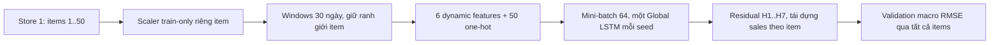

# Một cửa hàng, nhiều sản phẩm: Global ResidualAR

**IMPLEMENTED / TESTED / SMOKE TESTED / RUNTIME PROFILED / RUNTIME OPTIMIZED /
NUMERICAL EQUIVALENCE VERIFIED: YES. FULL GLOBAL EXPERIMENT: NOT RUN.**
Đã benchmark50items/seed42/2epochs trước/sau; chưa chạy full50items×5seeds/tối đa30epochs.
Kết quả hiện tại ở [runtime optimization](#runtime-optimization-ngày-2026-10-13);
các mục triển khai/smoke bên dưới giữ bằng chứng lịch sử tại ngày2026-10-12.

## Phạm vi ứng dụng

Pipeline nghiên cứu 12 independent representative series được giữ nguyên với toàn bộ artifact.
Pipeline ứng dụng mới: **Store 1, tất cả 50 items, một Global ResidualAR-MSE mỗi seed**.
50 items là dữ liệu của model chung, không phải 50 models hoặc 50 output neurons.
Full có 5 global fits cho seeds 42, 123, 2026, 7, 99. Không dùng Weekly macro 11,1435 của
12 chuỗi làm đối chứng; Weekly được tính lại trên đúng Store/items/windows của run mới.



## Dữ liệu, identity và scaler

`TimeSeriesAnalyzer.analyzeStoreQuietly` đọc CSV một lần, lọc store rồi sắp xếp từng item.
Global loader yêu cầu đủ IDs 1–50, lịch 2013-01-01..2017-12-31; missing/duplicate dates
bị SalesPreprocessor từ chối. Full không chọn đại diện hoặc bỏ item khó. Smoke chọn cố định
IDs 1,25,50 (không dựa metric); đây chỉ là tập nhỏ kiểm tra pipeline, không là đại diện thống kê.

Tái sử dụng SalesPreprocessor: train 2013–2015, validation 2016, test 2017; window 30→7,
feature warm-up 14 ngày, toàn bộ target trong một split. Global dataset giữ item/scaler cùng
window và không nối raw series. Test split được dựng như pipeline cũ nhưng không đưa vào
global training/evaluation. Test 2017 từng được quan sát lịch sử, không là pristine holdout.

Min–Max riêng item chỉ fit sales train; constant scale=1. Sáu features gồm sales, lag7,
rolling7/14, weekday sin/cos. Rolling dùng current/past theo policy cũ. One-hot 50 chiều
repeat mỗi timestep, channel = dynamicFeatureCount + itemId − 1; không có store embedding.
FeatureCount derive từ danh sách dynamic features và identity count: **56** cả full lẫn smoke.

```text
features: [batch,56,30]
labels: [batch,1,30]; label mask [batch,30], chỉ bước cuối = 1
label_i = (actual_i(t) - observed_i(t-7)) / trainSalesScale_i
salesPrediction_i = observed_i(t-7) + networkOutput_i * trainSalesScale_i
```

Không fit residual scaler, cộng trainMin, clip, Huber, log1p hoặc biến ngoài.
H1–H7 giữ cùng identity/scaler của item. Anchor kiểm tra targetDate−7; rollout feed sales đã
tái dựng và rebuild causal features từ history, actual tương lai chỉ tính metric.

## Model và batching

LSTM 32 units/TANH → output 1/IDENTITY, MSE, Adam 0,001. Tối đa 30 epoch, patience 5.
Chỉ có một network được tạo trong mỗi fit, nhận windows của toàn bộ items. Mỗi epoch shuffle
train windows bằng Java Random(seed + 1000003 × epoch), không đổi chronology trong sample.
Validation giữ thứ tự item/ngày, không shuffle, chia batch để giới hạn tensor memory.
Không weighting, oversampling hoặc undersampling; report window count từng item.

Batch mặc định 64 nằm trong ExperimentConfiguration; optional `--batch-size=32` hoặc 16 để
xử lý OOM có ghi nhận, không giảm items/history/horizon. Không tự đổi batch hoặc dữ liệu khi lỗi.
Tensor tạo từ float buffer trên CPU rồi copy theo batch; giải phóng tensor sau dùng. Best params
copy/restore theo **macro RMSE validation H1–H7 sales**; không theo pooled RMSE/scaled loss.
History chỉ giữ metric, không giữ predictions mọi epoch. Network giải phóng sau mỗi fit.
Chưa lưu network/checkpoint ra đĩa để deploy/resume; artifact hiện phục vụ validation experiment.

Train loss báo sample-weighted mean của score mini-batch sau update: weights thay đổi trong epoch,
không phải một lần score toàn bộ train tại weights cuối epoch. Đây không phải checkpoint criterion.
Lưu train_seconds và validation_seconds từng epoch để đo thời gian thay vì suy ra từ số fits cũ.

## Quy mô và bộ nhớ

Đã kiểm tra CSV thật: Store 1 đủ IDs 1–50, mỗi item 1.826 ngày, không trùng ngày.
Full theo protocol có 1.046 train windows/item và 360 validation origins/item:

| Quy mô | Full | Smoke |
| --- | ---: | ---: |
| Items | 50 | 3 (1,25,50) |
| Train windows | 52.300 | 3.138 |
| Validation origins | 18.000 | 1.080 |
| Forecasts/seed | 126.000 | 7.560 |
| Seeds/global fits | 5 | 1 |
| Epoch tối đa/fit | 30 | 2 |
| Training batches/epoch (64) | 818 | 50 |

Input batch64 float32 = 430.080 bytes ≈0,4102 MiB; labels + mask ≈0,01465 MiB.
Full input tensor nếu materialize là ≈335,17 MiB; implementation không tạo tensor đó.
Ước lượng này không gồm activations, gradients, CUDA workspace và Java objects/windows trên CPU;
không đồng nghĩa tổng VRAM/heap chỉ 0,41 MiB. Full runtime chưa đo, không ngoại suy từ 5 fits
của pipeline khác như thể mỗi fit có cùng chi phí.

## Lệnh chạy

```powershell
Set-Location 'C:\Users\quangTam\Documents\DL4j\sales-demand-forecasting-dl4j'
New-Item -ItemType Directory -Force output | Out-Null
mvn -B compile exec:java '-Dexec.args=--global-store-smoke'
```

Full (chủ động chạy riêng sau khi implementation/test/smoke đã kiểm chứng):

```powershell
Set-Location 'C:\Users\quangTam\Documents\DL4j\sales-demand-forecasting-dl4j'
$globalRunLog = 'output/global-full-' + (Get-Date -Format 'yyyy-MM-dd_HHmmss') + '.log'
mvn -B clean compile exec:java '-Dexec.args=--global-store=1' 2>&1 | Tee-Object -FilePath $globalRunLog
$globalExitCode = $LASTEXITCODE
```

Đổi store qua `--global-store=2` hoặc `--global-store-smoke=2`, không sửa source.
Ví dụ xử lý OOM: `'-Dexec.args=--global-store=1 --batch-size=32'`; đây phải là run mới có
manifest batch mới. Không compile/test/IDE auto-build khi train; lưu đủ log, không tail liên tục.

## Artifact schema 4

Reuse RunArtifactSession: directory độc quyền `output/runs/<run-id>/`, dataset SHA-256,
Java/backend, console.log, latest.txt, trạng thái RUNNING/SUCCESS/FAILED và ghi manifest nguyên tử.
Không sửa run cũ. Schema 1–3/legacy CLI vẫn giữ nguyên; global có tên CSV riêng:

- `global-series-scaling.csv`: store/item, train min/max/scale/mean, train/validation window count.
- `global-validation-predictions.csv`: store/item/seed/model, origin/target/horizon, actual_sales,
  weekly_baseline, predicted_residual và predicted_sales ở sales gốc.
- `global-item-seed-metrics.csv`: mỗi item/seed một dòng, MAE/RMSE, best epoch/epochs run/count.
- `global-epoch-history.csv`: mỗi seed/epoch một dòng, scaled train loss, macro/pooled MAE/RMSE,
  best flag và train/validation seconds. Một best flag mỗi global fit, không phải mỗi item.
- `summary.txt`, `error-analysis.txt`, `report.html`: dataset, overall, per-item, win rate,
  H1–H7, demand tiers theo train mean (chỉ report), seed stability.

Manifest ghi store/itemIds, identity mapping, dynamic/identity/total channels, batch, target/loss,
scaling policy, periods, checkpoint criterion, fits/seeds, tensor estimate và testUsedForSelection=false.
Full expected: 50 scaler rows, 250 item-seed rows, 630.000 prediction rows, 5 best flags.
SUCCESS chỉ sau export đủ và coverage đúng; Java failure/đóng session chưa complete ghi FAILED.
Kill JVM cưỡng bức/mất điện có thể để RUNNING; không coi partial là completed. Không resume.

## Aggregation và diễn giải

Mỗi seed: tính MAE/RMSE riêng item → mean đều qua items (primary macro); pooled metric tính
trên toàn bộ forecast points, báo riêng. Qua seeds: mean metric từng item → macro; overall
mean bằng mean per-seed macro. Dấu ± ở overall là sample std của per-seed macro, không là
std giữa items. Pooled RMSE overall là mean pooled RMSE qua seed, không ensemble predictions.
Win dùng item RMSE sau mean seed thấp hơn Weekly nghiêm ngặt; không coi hòa là thắng.
Tier sort train mean và item ID, chia tertile, giữ toàn bộ items trong train/evaluation.

Không yêu cầu model phải thắng Weekly. Không dùng smoke kết luận chất lượng full, không so
trực tiếp số liệu 12-series với Store1/50 items. Sau full mới phân tích 50 items/horizons/seed.
Chỉ đề xuất bước tiếp theo dựa trên kết quả: item embedding, global direct hoặc thí nghiệm khác
có protocol riêng; chưa triển khai chúng trong yêu cầu này.

## Tệp và kiểm chứng triển khai ngày 2026-10-12

Thêm SingleStoreGlobalDataset, GlobalBatch, GlobalMetrics, GlobalResidualLstmForecaster,
GlobalExperimentRunner, GlobalExperimentReport trong model; GlobalArtifactExporter trong output;
GlobalStoreTest trong tests. Sửa ExperimentConfiguration/Main để dispatch mode riêng,
TimeSeriesAnalyzer thêm đọc panel một pass, RunArtifactSession thêm manifest/complete global.
AR chỉ đổi visibility helper causal feature từ private sang package để reuse; không đổi thuật toán.
Không sửa SalesPreprocessor, các loss/forecaster cũ, dependency hoặc Java 11.

TDD RED: 2 failures, 0 errors do thiếu global CLI/dataset, log `output/global-tdd-red.log`.
Preprocessing focused đạt 3/3; focused mở rộng 6/6, log `output/global-focused.log`.
Sau bổ sung test 50 items: `mvn -B test` đạt **46/46**, 0 failures/errors/skips,
exit 0, BUILD SUCCESS trong 1:53 phút, log `output/global-suite-final.log`.

Test kiểm tra lọc store, đủ 50 IDs và số windows/full calendar, per-item scaler và constant scale,
train-only trước future extremes, không cross-item, containment split, tensor/mask/one-hot 50 chiều
lặp từng timestep, deterministic shuffle và batch cuối không mất sample. Test fake predictor
quan sát input H1–H7, xác nhận identity không đổi và actual tương lai không ảnh hưởng prediction;
zero residual khôi phục Weekly, output 0,25 tái dựng đúng scale mỗi item. Synthetic train nhiều
items dùng một model, restore min macro RMSE, thay test-only không đổi best epoch/metric;
macro khác pooled trên fixture biết đáp án. Artifact kiểm tra schema/coverage/unique keys/
reconstruction/SUCCESS/FAILED và thư mục riêng. Suite cũ không bị disable hoặc đổi expected.

Review: Java 11, chronology, all-item loading, mask/identity, residual, bounded batching, macro
checkpoint, artifact/report và legacy không thấy lỗi chặn trong phạm vi kiểm tra. Full 50-item
training chưa chạy; loader 50 items được kiểm tra bằng fixture đầy đủ, smoke chỉ train 3 items.

## Smoke thực tế và audit artifact

Run `2026-10-12_193415_770_gpu`, SUCCESS, JCublasBackend/Java 11.0.32.1, Store 1,
items 1/25/50, seed 42, 1 global fit, batch64, 2 epoch, chọn best epoch 2.
Maven exit 0/BUILD SUCCESS trong 1:50 phút; manifest từ 19:34:15 đến 19:35:54 giờ Việt Nam
(98,94 giây ứng dụng). Log đầy đủ `output/global-smoke-2026-10-12.log`.

| Model (SMOKE ONLY) | Macro MAE | Macro RMSE | Pooled RMSE | RMSE improvement vs Weekly |
| --- | ---: | ---: | ---: | ---: |
| Weekly | 8,606614 | 10,793978 | 11,201497 | 0% |
| GlobalResidualAR | 8,686371 | 10,844962 | 11,247555 | -0,4723% |

| Item | Tier trong smoke | Weekly RMSE | Global RMSE |
| --- | --- | ---: | ---: |
| 1 | LOW | 6,621634 | 6,694166 |
| 25 | HIGH | 13,503865 | 13,568110 |
| 50 | MEDIUM | 12,256437 | 12,272611 |

Global thắng 0/3 items trong smoke. Tier này tính chỉ trên 3 items, không đại diện tier toàn bộ
50 items. H1–H7 macro Global RMSE: 10,879873; 10,851695; 10,853352; 10,846535;
10,822555; 10,826913; 10,833677, đều cao hơn Weekly trong smoke. Một seed không đủ đánh giá
seed stability; std=0 chỉ vì n=1. Chưa có kết luận cho 50 items hoặc five-seed quality.

Audit trực tiếp 9 artifact: 3 scaling rows, 3 item-seed rows, 2 epoch rows, 1 best flag và
7.560 predictions (2.520/item, 360/horizon/item). Keys duy nhất, toàn bộ số hữu hạn, đủ H1–H7.
Metric tái tính khớp item-seed CSV trong `4,8131e-11`; reconstruction sai lệch tối đa
`1,4100e-14`. Macro/pooled tái tính khớp selected epoch trong `1e-5`; best flag trỏ epoch
có macro RMSE thấp nhất. Hash dataset khớp
`038f25690a65149c94f86ddd3deceda20c037a5cfd754cafdfc539a72992f2ed`.
Đối chiếu train 2013–2015 trong CSV xác nhận min/max/scale item 1 = 4/43/39,
item 25 = 24/132/108, item 50 = 19/103/84; tất cả 1.046 train windows/360 validation origins.

Epoch 1 train/validation = 31,182/13,372 giây; epoch 2 = 23,437/10,710 giây.
Ngoại suy tỷ lệ 50/3 cho khoảng **9,5–11 phút/epoch full**. Nếu cả 5 seeds chạy đủ 30 epoch
(150 epoch), khoảng **24–28 giờ**, còn early stopping có thể giảm; chưa phải thời gian full
đã đo, không phải SLA. Có thêm initial/final evaluation và overhead khác. Không thay batch,
metric hoặc giảm items để làm số này đẹp hơn. Cần giữ log và theo dõi thời gian thực tế khi
người dùng chạy full; nếu cần tối ưu sẽ profile riêng trước khi thay implementation.

Kiểm tra liên kết Markdown và `git diff --check` đạt. Không chạy full trong lượt này,
không đánh giá test 2017, không commit/push. Commit đề xuất:
`feat: add single-store global residual forecasting`.

## Runtime optimization ngày 2026-10-13

### 1. Trạng thái

GLOBAL IMPLEMENTED / TESTED / SMOKE TESTED / RUNTIME PROFILED / RUNTIME OPTIMIZED /
NUMERICAL EQUIVALENCE VERIFIED: **YES**. FULL GLOBAL EXPERIMENT: **NOT RUN**.
Benchmark dùng Store 1, đủ 50 items, seed 42, 2 epochs, batch 64.
Full vẫn 5 seeds × tối đa 30 epochs, patience 5; giữ model, dữ liệu, scaling, RNG và protocol.

### 2. Bottleneck đo được

BEFORE: train 652,193s (54,22%), validation 543,474s (45,18%), data 1,259s (0,10%),
artifact 2,721s (0,23%); còn lại là init, hash audit và overhead.
Train fit mất 517,474s, score 132,907s; validation model.output mất 537,740s.
Validation đã batch 64 từ đầu: ceil(18.000/64) × 7 = 1.974 calls/evaluation.
Lần đánh giá lại checkpoint cuối mất 187,425s dù kết quả đã được tính ở epoch được chọn.

Tensor train 1,552s, tensor validation 3,308s, đọc output 0,812s, dựng feature 0,281s,
metrics 0,052s và export predictions 2,598s. Các phần này không phải bottleneck chính,
nên không thêm cache toàn bộ tensors, threading, sửa scalar reads hoặc dependency.

### 3. BEFORE benchmark

Run `2026-10-12_201423_002_gpu`: SUCCESS, Maven exit 0 / BUILD SUCCESS 20:08,
ứng dụng 20:02,922. JCublasBackend, Java 11.0.32.1, RTX 4050 Laptop.
Dataset SHA-256: `038f25690a65149c94f86ddd3deceda20c037a5cfd754cafdfc539a72992f2ed`.
Train epochs 307,552 / 344,664s; validation 185,594 / 170,457s; final evaluation 187,425s.
52.300 train windows, 818 batches/epoch (last 12), 18.000 validation origins,
282 validation batches (last 16), 126.000 forecasts/evaluation. Ba evaluations, 5.922 output calls.

### 4. Tối ưu thực tế

GlobalResidualLstmForecaster giữ `bestValidation` immutable khi copy best params.
Mỗi improvement thay snapshot; epoch sau kém hơn vẫn giữ snapshot best trước đó.
Cuối fit vẫn restore best params, trả predictions/metrics đã tính ở đúng weights đó.
Mọi epoch vẫn đánh giá đầy đủ; không thay checkpoint frequency, tolerance 1e-8,
training order, score, dtype, scalar arithmetic, optimizer hoặc network definition.
Đây là tái sử dụng kết quả của cùng phép tính đã hoàn tất; population giữ nguyên.

History chỉ giữ metrics và một snapshot predictions của best epoch.
Thêm nanoTime profile, benchmark CLI riêng, window fingerprints và script audit.
Invoke-GlobalRun.ps1 tạo source/build riêng trong output/, giữ cwd ở repo gốc và lưu log/exit code.

### 5–6. AFTER và speedup

Run `2026-10-13_002648_831_gpu`: cùng dataset/config/backend, SUCCESS, exit 0,
Maven 17:53; ứng dụng 17:40,531. Train epochs 546,332 / 235,937s;
validation 143,552 / 126,814s. Hai evaluations, 3.948 calls; final result lấy từ cache.
Số predictions xuất cuối run vẫn **126.000**.

| Phase (seconds) | Before | After | Before/after |
| --- | ---: | ---: | ---: |
| Data preparation | 1,259 | 2,333 | 0,540× |
| Training total, 2 epochs | 652,193 | 782,259 | 0,834× |
| Validation total, gồm final ở BEFORE | 543,474 | 270,364 | 2,010× |
| Artifact/report | 2,721 | 2,448 | 1,112× |
| Application total | 1.202,922 | 1.060,531 | **1,134×** |

Tiết kiệm 142,391s (2:22,391), **11,84%** tổng benchmark.
Train code không đổi nhưng chậm hơn 130,067s; timing khác nhau rõ giữa các epoch.
Một cặp run khác giờ/tải máy/warm-up/nhiệt/power không cô lập được mọi nguyên nhân nhiễu.
Không diễn giải validation total 2,01× là inference kernel nhanh gấp đôi.
Bằng chứng cấu trúc: bỏ 1.974 calls lặp/fit, giữ toàn bộ validation từng epoch và cùng outputs.
Không bỏ epoch đầu khỏi số đo, không warm-up riêng.

Train trung bình 326,096 → 391,130s/epoch; toàn mini-batch trung bình 0,398625 → 0,478141s,
vẫn 818 batches/epoch. Train + validation trung bình 504,134 → 526,312s/epoch.
Cache tiết kiệm một evaluation cuối fit, không làm training nhanh hơn.

### 7. Numerical equivalence

`python scripts/compare_global_benchmarks.py output/runs/2026-10-12_201423_002_gpu output/runs/2026-10-13_002648_831_gpu --output output/global-performance-comparison.json`
exit 0 / PASS. Tolerance cố định trước tối ưu **1e-9 sales**, không nới sau benchmark.

- Max/mean absolute prediction difference = 0 ở precision CSV 10 decimals, đủ 126.000 rows.
- Macro MAE/RMSE, pooled MAE/RMSE, per-item MAE/RMSE, epoch loss/metrics difference = 0.
- Weekly, actual, ordered keys và scaler CSV giống nhau; best epoch = 2 ở cả hai.
- Đủ 50 item metrics, 50 scaler rows, 2 epoch rows, 1 best flag; không duplicate/nonfinite,
  thiếu horizon hoặc sai ngày. Target date = origin + horizon và thuộc validation 2016.
- Train windows SHA-256: `7a8bb38c2c073ff6088ffb862454877c4078908e18dcecf250b1577e6ff1e1a7`.
- Validation windows SHA-256: `7d115f7cc07df8dc4c995c8ca6be38e3e6f581e1bd844402bf5b40fdb7835a2b`.
  Hash bao gồm ordered item/scaler/dates/raw/normalized targets/inputs/features ở exact double bits.
- Recompute per-item metrics lệch tối đa 4,936e-11; reconstruction CSV 1,001e-10 do làm tròn.
  Không tuyên bố bit-identical weights hoặc full-precision predictions chưa xuất.

Benchmark macro MAE/RMSE = 7,7605530704 / 9,7600911319; pooled RMSE = 10,0967482487.
Chỉ dùng để kiểm tra equivalence; chưa kết luận chất lượng 5 seeds hoặc dùng quality chọn tối ưu.

### 8–9. Tests và review

RED benchmark CLI: 1 failure/0 errors vì mode chưa tồn tại, output/global-profile-red.log.
RED cache: 1 failure/0 errors đúng 3 evaluations thay vì 2, output/global-cache-red.log.
Focused 12/12 PASS, output/global-cache-focused.log.
Full suite **51/51 PASS**, 0 failures/errors/skips, exit 0 / BUILD SUCCESS 2:12,
output/global-cache-suite.log. Giữ nguyên 46 tests cũ.

Năm tests mới kiểm benchmark/profile, oracle C/F layout, batch cuối, input tensors từng horizon,
dates/anchors/residual/per-item/macro/pooled, deterministic shuffle, future actual mutation
với predictor phụ thuộc history và best epoch 1 khác last epoch 2.
Legacy global synthetic smoke và old research regression nằm trong full suite.
Smoke thực tế qua script mới: `2026-10-13_005123_869_gpu`, SUCCESS, exit 0 / BUILD SUCCESS
59,509s Maven, items 1/25/50, seed 42, 2 epochs/best 2; macro RMSE 10,844962.
Predictions CSV khớp smoke lịch sử cùng config; log output/global-script-smoke.log.

Review source/diff không thấy lỗi chặn trong scope đã kiểm: immutable cache gắn đúng checkpoint,
không RNG calls mới, không future actual inference/teacher forcing, scaler train-only,
đầy đủ population/checkpoint frequency/export. Không đổi dependencies hoặc Java 11.

### 10. Ước lượng full từ benchmark 50 items

AFTER train + validation epoch 1 = 689,884s, epoch 2 = 362,751s, mean 526,312s (**8,772 phút**).
Nếu 5 seeds × 30 epochs (150 epochs), lấy mean ước **21,93 giờ**, cộng init/export nhỏ.
Lấy hai tốc độ epoch đã thấy cho **15,11–28,75 giờ**; đây không là bound phần cứng hoặc SLA.

Chưa có cơ sở dự đoán early stopping của global full. Minh họa nếu 10 epochs/seed thì mean
ước 7,31 giờ, không dự đoán sẽ dừng ở 10. Earliest patience 5 có thể 6 epochs nếu best 1
và 5 epochs không cải thiện. Cache chỉ tiết kiệm một validation/fit nên tỷ lệ lợi ích giảm khi
mỗi fit chạy nhiều epochs. Số đo 50 items thay ngoại suy từ smoke 3 items trước đây.

### 11. Full command đã chuẩn bị, CHƯA thực thi

```powershell
Set-Location 'C:\Users\quangTam\Documents\DL4j\sales-demand-forecasting-dl4j'
New-Item -ItemType Directory -Force output | Out-Null
.\scripts\Invoke-GlobalRun.ps1 -Mode Full
```

Script gọi `mvn -B -f <snapshot>/pom.xml compile exec:java '-Dexec.args=--global-store=1'`,
Tee-Object log timestamp, lưu exit code riêng và fail nếu Maven khác 0; cwd vẫn repo gốc.
Full là **5 global fits**, 126.000 predictions/seed, 630.000 rows cuối.
`-Mode Benchmark` chạy 50 items/seed 42/2 epochs; `-Mode Smoke` chạy 3 items.

### 12–13. Tệp và artifact

Thêm GlobalPerformanceProfile, GlobalDataFingerprint, GlobalPerformanceTest,
ReferenceGlobalValidation test oracle, scripts/compare_global_benchmarks.py và Invoke-GlobalRun.ps1.
Sửa ExperimentConfiguration/Main/GlobalExperimentRunner/Report/GlobalResidualLstmForecaster,
SingleStoreGlobalDataset/TimeSeriesAnalyzer/SalesPreprocessor (overload instrumentation),
GlobalArtifactExporter/RunArtifactSession và README/docs. Không đổi pom/dependencies/Java 11.

Global run bổ sung `performance-profile.json` và manifest benchmark flag; CSV/header/precision giữ nguyên.
Profile có nested phases, không cộng mọi row; host wall time, không là CUDA kernel profiler.
Scope từ GlobalRunner entry qua export/manifest, loại Maven/ND4J startup/hash session ban đầu,
final profile serialization/console summary; Maven total báo riêng.

BEFORE/AFTER artifacts ở output/runs/ hai run IDs trên; performance-profile.json trong mỗi run.
Logs: output/global-profile-before-isolated.log và global-profile-after-isolated.log.
Audit: output/global-performance-comparison.json. Không sửa artifact của run cũ.

Baseline đầu `2026-10-12_195613_061_gpu` FAILED sau 15:50 do NoSuchMethodError Epoch constructor.
Class trong target bị ghi lại trong lúc JVM chạy; class timestamp/IDE Java cho thấy xung đột
compiler. Không dùng run lỗi làm benchmark. Build cô lập trước/sau đều SUCCESS.

### 14–16. Giới hạn, hướng tiếp và commit

Một cặp benchmark/seed 42/hai epochs; chưa đo lặp nhiều lần hoặc nhiều seeds.
CPU load/power/warm-up không cố định. Chưa có accuracy claim 5 seeds/test 2017.
Cache thêm một snapshot CPU 126.000 immutable predictions khi epoch sau chạy, ước 8–16 MiB
với giả định 64–128 bytes/row; đây không phải heap profile. Không giữ GPU tensors thêm.
Batch input 0,4102 MiB, labels + mask 0,01465 MiB; không materialize full train inputs 335,17 MiB.
Global windows là Java objects/shared feature references, chưa đo exact heap size.
GPU snapshot BEFORE 46%/2.192 MiB lúc 20:18 là một mẫu, không là peak hoặc utilization average.
Chưa có checkpoint disk/resume; build snapshots/logs giữ để audit, không tự xóa.

Automation kiểm tra mỗi 10 phút đã **PAUSED** theo yêu cầu ngày 2026-10-13.
Có thể chạy FULL GLOBAL EXPERIMENT khi người dùng chủ động yêu cầu: tests/benchmark/equivalence đạt.
Full chưa chạy; không commit/push.

**Commit đề xuất:** `perf: optimize global forecasting runtime without changing protocol`.

## Chuẩn bị deployment global 3 seed ngày 2026-10-13

Phần này thay thế cấu hình full 5 seed ở các mục lịch sử bên trên cho **lượt deployment mới**;
không sửa ý nghĩa của experiment nghiên cứu 5 seed cũ. `ExperimentConfiguration` là nguồn duy
nhất cho seed global: mặc định `[42,123,2026]`, CLI nhận `--seeds=...` theo đúng thứ tự để retry.
Full dự kiến 3 fits, 150 item-seed rows và 378.000 prediction rows.

Mỗi epoch vẫn đánh giá toàn bộ validation H1–H7 ở sales gốc. Khi validation Macro RMSE cải thiện,
DL4J ghi file tạm, restore model, so tham số và prediction với model đang chạy, rồi atomic move
thành `models/seed-<seed>/model.zip`. Metadata chỉ ghi `usable=true` sau khi model load-verify.
Epoch cuối không tự thắng. Selector dùng Macro RMSE thấp nhất; tie-break Macro MAE rồi seed ID.
Không đọc test 2017, average weights, ensemble hoặc train lại model thắng.

`deployment/` copy model thắng và gồm metadata, scaler train-only, mapping 50 item, schema 56 kênh
và selection JSON. Metadata có dataset SHA-256, protocol/runtime thực tế, H1–H7 và đường dẫn tương
đối. Mapping cố định item 1..50 → identity 0..49 → channel 6..55.

Preflight không tạo/fit network; nó kiểm dataset, Store 1, item/coverage/duplicate/missing,
52.300 train windows, 18.000 validation origins, 126.000 forecasts/seed, backend và quyền ghi.
CPU backend sinh WARNING. Quy trình portable:

```powershell
.\scripts\Invoke-GlobalTraining.ps1 -Preflight
.\scripts\Invoke-GlobalTraining.ps1
.\scripts\Audit-GlobalRun.ps1
```

Script dùng build snapshot cô lập, Tee log và lưu exit code. Audit yêu cầu `SUCCESS`, đủ artifact,
150 metric rows và 378.000 predictions. Full 3 seed **chưa chạy**, nên chưa có model thật được chọn.

## Protocol RTX 3090: calibration batch và full tối đa 10 epoch

Quyết định ngày 2026-10-13 này supersede batch 64/max 30 cho future deployment run. Một command
chạy tuần tự: preflight; smoke GPU 3 items với train/validation batch 64/256; ba calibration
toàn bộ 50 items bằng seed 42, đúng một epoch cho các cặp 64/256, 128/512, 256/1024; sau đó full
ba seed với cặp được chọn và tối đa 10 epoch, patience vẫn 5.

Calibration ghi Macro RMSE validation sales gốc và `train_seconds + validation_seconds` của epoch.
Baseline là 64/256. Ứng viên hợp lệ nếu RMSE không cao hơn baseline quá 1%; trong tập hợp đó chọn
sec/epoch thấp nhất, rồi RMSE thấp hơn, rồi train batch nhỏ hơn. `calibration-selection.json` ghi
policy, threshold, baseline, limit, toàn bộ candidates và selected pair. Calibration không tạo
deployment package; chỉ full mới lưu checkpoint mỗi seed và `deployment/model.zip`.

Batch size là thay đổi hiệu năng đã được người dùng phê duyệt, không đổi tensor channels/window,
target, scaler train-only, validation population hoặc model selection. Một epoch calibration chỉ
là phép chọn cấu hình vận hành; không là kết luận chất lượng model. Chưa chạy workflow này trên
RTX 3090 nên khoảng 10–30 phút chưa được xác nhận bằng đo thực tế.
